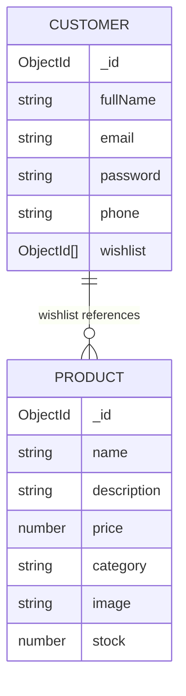

# ShopKart Backend API — Authentication, Catalog & Wishlist (Labs 01, 03 & 04)

[](test/test-runner.js)
[](https://nodejs.org/)
[](https://expressjs.com/)
[](https://mongoosejs.com/)

---

## 📁 Backend Structure

```text
backend/
│
├── controllers/
│   ├── customer.controller.js  # Auth handlers (register, login, profile, logout, change-password)
│   ├── product.controller.js   # Product handlers (create, list with search/filter/sort, single item)
│   └── wishlist.controller.js  # Wishlist handlers (add, get with populate, remove, toggle)
│
├── models/
│   ├── customer.model.js       # Customer schema, wishlist ObjectId refs, bcrypt hashing
│   ├── user.model.js           # User/Customer compatibility bridge
│   └── product.model.js        # Product schema, price > 0, stock >= 0 validations
│
├── routes/
│   ├── customer.routes.js      # Customer REST routes with protection middleware
│   ├── product.routes.js       # Product REST routes (/products, /products/:id)
│   └── wishlist.routes.js      # Protected wishlist REST routes (/wishlist)
│
├── middlewares/
│   └── auth.middleware.js      # JWT cookie & Bearer token verification, req.user attachment
│
├── utils/
│   ├── generateToken.js        # JWT signing & HttpOnly cookie configuration
│   └── seedProducts.js         # Realistic product catalogue seeder
│
├── test/
│   └── test-runner.js          # Automated test runner (38 test assertions)
│
├── .env                        # Backend environment configuration
├── .env.example                # Example configuration template
├── package.json                # Dependencies and npm scripts
├── index.js                    # Application entry point & MongoDB connection
├── README.md                   # Documentation & TA Viva Preparation Guide
└── ShopKart_API.postman_collection.json # Comprehensive Postman collection
```

---

## 📡 API Reference & Specifications

### 1. Customer Authentication APIs (Lab 01)
- `POST /customers/register`: Registers a customer with bcrypt password hashing.
- `POST /customers/login`: Authenticates customer and sets HttpOnly JWT cookie.
- `GET /customers/me`: Protected route returning authenticated customer profile.
- `POST /customers/logout`: Clears the HttpOnly cookie.
- `PATCH /customers/change-password`: Bonus Challenge endpoint to update password.

### 2. Product Catalog APIs (Lab 03)
- `POST /products`: Creates a new product document with validation (`price > 0`, `stock >= 0`).
- `GET /products`: Returns all products with dynamic query parameters (`?search=...`, `?category=...`, `?sort=price_asc|price_desc`).
- `GET /products/:id`: Fetches a single product by MongoDB ObjectId with 400 (invalid ID format) and 404 (not found) error handling.

### 3. Wishlist Management APIs (Lab 04)
All wishlist endpoints are protected by `protectRoute` middleware. The user identity is extracted strictly from the authenticated JWT session (`req.user`), never accepted from the request body or parameters.

| Method | Endpoint | Auth | Purpose | Status Codes |
|---|---|:---:|---|:---:|
| `POST` | `/wishlist/:productId` | ✅ | Add product ObjectId reference to user's wishlist | `200`, `400`, `401`, `404`, `409` |
| `GET` | `/wishlist` | ✅ | Get current user's wishlist populated with product details | `200`, `401` |
| `DELETE` | `/wishlist/:productId` | ✅ | Remove product reference from user's wishlist | `200`, `400`, `401`, `404` |
| `PATCH` | `/wishlist/:productId/toggle` | ✅ | **Bonus (+10 Marks):** Toggle wishlist membership | `200`, `400`, `401`, `404` |

---

## 🗃️ MongoDB Relationship Design



### Why Store ObjectIds instead of Embedded Product Objects?
1. **Single Source of Truth:** If product price, stock level, name, or image updates, the wishlist reflects the latest information immediately without stale data synchronization issues.
2. **Document Size Optimization:** User documents remain compact. Storing full product snapshots would duplicate data across potentially thousands of users, bloating the database.
3. **Mongoose `populate()`:** Allows the server to dynamically hydrate product details at read time using:
   ```javascript
   User.findById(userId).populate({
     path: 'wishlist',
     select: 'name description price category image stock createdAt'
   });
   ```

---

## 🧪 Automated Testing
```bash
npm test
```
Runs the automated test runner ([test/test-runner.js](test/test-runner.js)) verifying **38 test assertions**:
- 18 Authentication & Cookie Session tests (Lab 01)
- 9 Product Catalog & Filtering tests (Lab 03)
- 11 Wishlist Model, Validation, Conflict Prevention & Populate tests (Lab 04)
