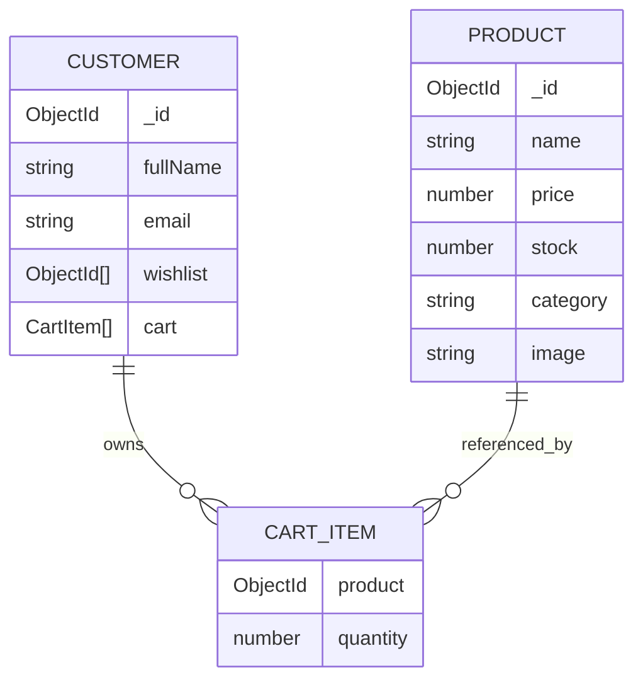

# ShopKart Backend API — Authentication, Catalog, Wishlist & Cart (Labs 01–05)

[](test/test-runner.js)
[](https://nodejs.org/)
[](https://expressjs.com/)
[](https://mongoosejs.com/)

---

## 📁 Backend Structure

```text
backend/
│
├── controllers/
│   ├── customer.controller.js  # Auth handlers (register, login, profile, logout, change-password)
│   ├── product.controller.js   # Product handlers (create, list with search/filter/sort, single item)
│   ├── wishlist.controller.js  # Wishlist handlers (add, get with populate, remove, toggle)
│   └── cart.controller.js      # Cart handlers (add/increment, get populated, update qty, remove)
│
├── models/
│   ├── customer.model.js       # Customer schema (wishlist & cart references, bcrypt hashing)
│   ├── user.model.js           # User/Customer compatibility bridge
│   └── product.model.js        # Product schema, price > 0, stock >= 0 validations
│
├── routes/
│   ├── customer.routes.js      # Customer REST routes with protection middleware
│   ├── product.routes.js       # Product REST routes (/products, /products/:id)
│   ├── wishlist.routes.js      # Protected wishlist REST routes (/wishlist)
│   └── cart.routes.js          # Protected shopping cart REST routes (/cart)
│
├── middlewares/
│   └── auth.middleware.js      # JWT cookie & Bearer token verification, req.user attachment
│
├── utils/
│   ├── generateToken.js        # JWT signing & HttpOnly cookie configuration
│   └── seedProducts.js         # Realistic product catalogue seeder
│
├── test/
│   └── test-runner.js          # Automated test runner (50 test assertions)
│
├── .env                        # Backend environment configuration
├── .env.example                # Example configuration template
├── package.json                # Dependencies and npm scripts
├── index.js                    # Application entry point & MongoDB connection
├── README.md                   # Documentation & TA Viva Preparation Guide
└── ShopKart_API.postman_collection.json # Comprehensive Postman collection
```

---

## 📡 API Reference & Specifications

### 1. Customer Authentication APIs (Lab 01)
- `POST /customers/register`: Registers a customer with bcrypt password hashing.
- `POST /customers/login`: Authenticates customer and sets HttpOnly JWT cookie.
- `GET /customers/me`: Protected route returning authenticated customer profile.
- `POST /customers/logout`: Clears the HttpOnly cookie.
- `PATCH /customers/change-password`: Bonus Challenge endpoint to update password.

### 2. Product Catalog APIs (Lab 03)
- `POST /products`: Creates a new product document with validation (`price > 0`, `stock >= 0`).
- `GET /products`: Returns all products with dynamic query parameters (`?search=...`, `?category=...`, `?sort=price_asc|price_desc`).
- `GET /products/:id`: Fetches a single product by MongoDB ObjectId with 400 (invalid ID format) and 404 (not found) error handling.

### 3. Wishlist Management APIs (Lab 04)
- `POST /wishlist/:productId`: Adds product ObjectId reference to user's wishlist (`409 Conflict` on duplicates).
- `GET /wishlist`: Returns current user's populated wishlist items.
- `DELETE /wishlist/:productId`: Removes product reference from user's wishlist.
- `PATCH /wishlist/:productId/toggle`: Bonus Challenge toggle endpoint.

### 4. Shopping Cart APIs (Lab 05)
All cart routes are protected with `protectRoute`. User identity is derived strictly from `req.user`.

| Method | Endpoint | Auth | Purpose | Status Codes |
|---|---|:---:|---|:---:|
| `POST` | `/cart/:productId` | ✅ | Add product to cart (or increment quantity if already present). Validates stock limits. | `200`, `400`, `401`, `404` |
| `GET` | `/cart` | ✅ | Get current user's cart populated with Product details (`name`, `price`, `stock`, `image`, `category`). | `200`, `401` |
| `PATCH` | `/cart/:productId` | ✅ | Update quantity for an existing cart item (`quantity >= 1`, `quantity <= stock`). | `200`, `400`, `401`, `404` |
| `DELETE` | `/cart/:productId` | ✅ | Remove product item from user's cart. | `200`, `400`, `401`, `404` |

---

## 🗃️ MongoDB Relationship Design



### Why Cart Needs Quantity While Wishlist Does Not
A **Wishlist** is a binary bookmarking system (*"I like this"* vs *"I don't"*). Storing an `ObjectId` is sufficient.  
A **Shopping Cart** represents a pre-purchase commitment where the user decides *how many units* to purchase right now. Therefore, each cart entry must couple a `product` reference with a positive integer `quantity`.

### Why Product Prices Are Not Copied into Cart
Copying prices into the cart document introduces a **stale data anomaly**. If the store updates a price or runs a promotion, cart snapshots would show outdated numbers. Referencing the `Product` collection ensures all pricing and inventory remain linked directly to the database single source of truth.

---

## 🧪 Automated Testing
```bash
npm test
```
Runs the automated test runner ([test/test-runner.js](test/test-runner.js)) verifying **50 test assertions**:
- 18 Authentication & Cookie Session tests (Lab 01)
- 9 Product Catalog & Filtering tests (Lab 03)
- 11 Wishlist Model, Validation & Populate tests (Lab 04)
- 12 Shopping Cart Schema, Increment, Stock Limitation, Quantity Update & Removal tests (Lab 05)
